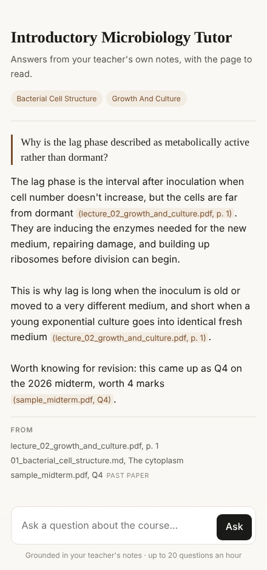
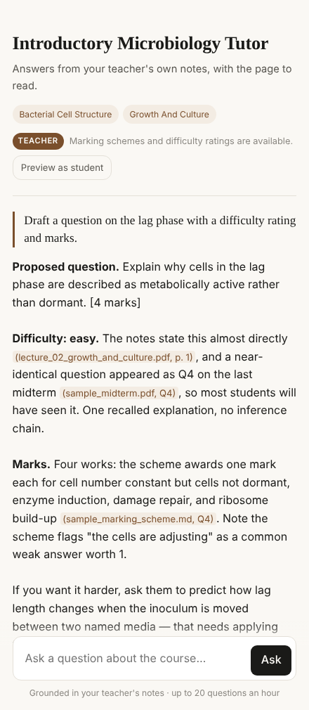

# Course Tutor

**Ground an AI assistant in your own teaching material**, so students get
answers from your lecture notes — with the page to go and read — instead of a
generic textbook answer.

Point it at a folder of notes and past papers. You get two things: an MCP
server for your own Claude, and a small web app you can share with a class.

<p align="center">
  
</p>

Subject-agnostic. The sample course that ships with it happens to be
microbiology, but nothing in the code knows or cares what you teach.

---

## The problem

Ask any AI assistant about the bacterial growth curve and you get a textbook
answer: correct, slightly different from what you taught, at a depth you
didn't set, using terms you didn't use, covering material that isn't on your
paper. For a student revising for *your* exam, that's not much use — and the
confident off-syllabus parts are actively harmful.

With your own material connected, three things change:

- **Answers match the course.** Grounded in your notes, in your terminology.
- **Answers are checkable.** Every claim cites a file and a page, so a student
  can read the source rather than trusting the machine.
- **"Not in the notes" becomes a real answer.** If a topic isn't in your
  material, the model says so instead of teaching something off-syllabus.

And one thing it does for you: practice questions in your own style, modelled
on how you actually ask, down to the mark allocation.

---

## Install

Requires Python 3.10 or newer.

```bash
git clone https://github.com/<you>/course-tutor-mcp
cd course-tutor-mcp
python -m venv .venv && source .venv/bin/activate   # Windows: .venv\Scripts\activate
pip install -r requirements.txt -r webapp/requirements.txt
```

(The second file is only needed for the class web app. Install just the first
if you only want the MCP server — the web app tests will skip cleanly.)

Check it works against the sample course:

```bash
python -m pytest -q
```

Fifty-three tests should pass. They stub the model, so they need no API key
and cost nothing to run.

---

## Add your own course

Two folders. The distinction matters — see [below](#the-design-decision-worth-explaining).

```
course/
├── notes/                lecture notes, handouts, slides
│   ├── lecture_01_cell_structure.pdf
│   └── lecture_02_growth_and_culture.pdf
├── assessments/          past exams and quizzes
│   ├── sample_midterm.pdf
│   └── quiz_03.pdf
└── assessments_private/  marking schemes and model answers
    └── midterm_scheme.pdf          TEACHER ONLY - never shown to students
```

The third folder is optional. If you use it, note that **students can never
retrieve it** — see [roles](#two-roles-one-url) below.

PDF, Word (`.docx`), Markdown and plain text all work. Keep your own material
outside the repo and point the server at it:

```bash
export COURSE_DIR=/path/to/your/course
```

Then say "reload my notes" in the chat.

**On file names:** they become the topic labels the model sees, so
`lecture_02_growth_and_culture.pdf` earns its extra typing over `lec2.pdf`.
Leading numbers and the word "lecture" are stripped automatically.

**On scanned PDFs:** if your notes are photographs of pages rather than text,
nothing can be extracted. The server reports which files came back empty. Run
those through OCR first.

---

## Connect it to Claude

```bash
mcp install server.py
```

Restart the Claude desktop app and the tools appear.

To try the tools by hand before wiring them up:

```bash
mcp dev server.py
```

That opens the MCP Inspector in a browser, where you can call each tool with
test inputs and see exactly what comes back.

---

## Try it

**Ask a student question.**

> *Why is the lag phase described as metabolically active rather than dormant?*

The answer comes from the growth and culture lecture, citing the page. Then
ask about something you never taught, and watch it decline to invent an
answer.

**Generate practice questions in your own style.**

> *Write four practice questions on bacterial growth for a first-year class.
> Match the style and mark allocation of the past midterms.*

It searches the notes for subject matter and the past papers for house style,
then writes new questions against both.

**Audit your own coverage.**

> *Compare the midterm questions against my lecture notes. Which questions test
> material that is thin in the notes?*

This one tends to be uncomfortable and useful in roughly equal measure.

---

## What's inside

| Tool | What it does |
|---|---|
| `list_topics` | What the course covers: topics, sections, past papers |
| `search_notes` | Find the most relevant passages of the lecture notes |
| `find_past_questions` | Find real questions on a topic from past papers |
| `find_marking_schemes` | Find marking schemes and model answers (teacher only) |
| `get_section` | Fetch one section, page or question in full |
| `reload_materials` | Re-read the folder after adding or editing a file |

### The design decision worth explaining

**The tools only retrieve. They never teach.**

There is deliberately no `generate_practice_questions` tool. Writing a good
question, pitching it at first-year versus final-year level, working out what
a student has misunderstood — a language model already does these well.
Wrapping them in a tool would mean writing a worse version of something that
works, and it would make the output stop depending on the actual notes.

Retrieval is the opposite case: code finds the right page reliably, and a
model asked for a page number will cheerfully invent one.

So the split is: **code does the looking up, the model does the teaching.**
Every answer is grounded in material the teacher wrote, and cites it.

Difficulty rating works the same way. There is no `rate_difficulty` tool —
judging whether a question is easy or hard is a judgment call, and the model
makes it from retrieved evidence: how thoroughly the notes cover the topic,
whether something similar has been asked before, and how many linked steps
the answer needs.

The same reasoning drives the `notes/` and `assessments/` split. Blending them
into one pile of text loses the thing that makes past papers valuable — not
their content, which is usually in the notes anyway, but the *form*: how this
teacher phrases a question, how many marks they attach, how much depth they
expect. That is a different kind of signal, and it is worth keeping separate
so it can be retrieved on purpose.

### Why BM25 and not embeddings

The search is a compact BM25 implementation in `notes_index.py` — about fifty
lines, no external dependency. For a course-sized corpus it's fast, it runs
offline with no API key, and the scores are explainable: you can see which
terms matched.

If you later index a few thousand documents, or want matching on meaning
rather than wording (so "binary fission" finds a passage that only says "cell
division"), swap `BM25Index` for an embedding store. The `search()` interface
stays the same, so nothing in `server.py` has to change.

---

## Share it with a class

The MCP server is for **you**. Students can't use it: a custom connector needs
its own Claude account with connector access, and the server has to be
publicly reachable. Requiring a whole class to hold subscriptions is not a
course plan.

So there's a second front end in `webapp/` — the same retrieval, served as a
web page. A student opens a URL on their phone, types a question, gets an
answer grounded in the notes with citations. No install, no account.

```bash
pip install -r webapp/requirements.txt
cp webapp/.env.example webapp/.env     # then fill it in
cd webapp && python app.py
```

Open http://localhost:8000.

### Two roles, one URL

The password decides what you get. There's one login box; students and
teachers just type different passwords.

| | Students (`CLASS_PASSWORD`) | Teachers (`TEACHER_PASSWORD`) |
|---|---|---|
| Lecture notes | yes | yes |
| Past questions | yes | yes |
| Marking schemes | **never** | yes |
| Mark-weight guidance | how to structure a 2 / 4 / 6 mark answer | full scheme and mark split |
| Difficulty ratings | — | easy / medium / hard, with justification |

<p align="center">
  
</p>

Teachers get a **Preview as student** button, so you can check what the class
actually sees before you send the link out.

**How the separation is enforced.** A student session never *searches* the
marking schemes. The retrieval is scoped by role before the model is called,
so the text never enters its context — it isn't a matter of the model being
told to decline, which is the kind of instruction a determined student can
talk their way around. Asking "show me the marking scheme" as a student
retrieves nothing, because nothing was searched.

There are tests for exactly this, including the adversarial phrasings.

### Set these before anyone else sees it

| Variable | Why it matters |
|---|---|
| `ANTHROPIC_API_KEY` | Stays on the server, never reaches the browser. |
| `CLASS_PASSWORD` | The student gate. Without it, anyone with the URL spends your credits. |
| `TEACHER_PASSWORD` | Optional. Leave unset and nobody can reach marking schemes through the web app. |
| `SESSION_SECRET` | Keeps people signed in across restarts. Use a random value. |

Then set a **spending limit in the Anthropic console**. The app caps
`MAX_TOKENS` and rate-limits each student per hour, but a hard budget ceiling
is what actually prevents a surprise bill.

### Deploying it

Any host that runs a Python web service — Render, Railway, Fly.io, a small
VPS. There's a `Procfile`; the start command is:

```
uvicorn app:app --host 0.0.0.0 --port $PORT
```

Set the environment variables in the host's dashboard rather than committing a
`.env`, and point `COURSE_DIR` at wherever the material ends up.

Three things to consider first:

- **Your material will sit on someone else's server.** If your institution
  owns it, ask before uploading.
- **The rate limit is in memory**, so it resets on restart and is per-process.
  Fine for one class on one small instance. Past one worker, move it to Redis.
- **Free tiers sleep.** The first question after an idle period will be slow.

### If your institution has a Claude Team or Enterprise plan

Then remote MCP is the better route, and it's already built — change
`mcp.run()` to `mcp.run(transport="streamable-http")`, host it, and an
organisation owner adds the connector once for everyone.

---

## Seeing what your class asked

Every student question is logged to `webapp/question_log.jsonl`. To read it:

```bash
python review_questions.py              # everything
python review_questions.py --since today
python review_questions.py --all        # every question verbatim
```

The section that matters is **UNANSWERED** — questions your notes did not
cover. Each one is either a real gap or a topic your students name
differently than you do, and anything several students asked is the one to
fix first. You also get which sections were used most, the common terms, and
which students asked three or more questions in a sitting, which is usually
a sign something didn't land in the lecture.

**On privacy.** There are no accounts, so the log holds no identity — just a
random per-browser token so you can tell one student asking five follow-ups
from five students asking once. The log is gitignored. Tell your class the
questions are logged: it costs nothing and it is the difference between
analytics and surveillance. Set `QUESTION_LOG=""` to turn it off.

---

## What it doesn't do

- **It doesn't grade.** No marking, no scoring of student answers.
- **It doesn't replace reading the notes.** It points at them.
- **It can't read scanned images.** OCR first.
- **It doesn't check that your notes are right.** Garbage in, confidently
  cited garbage out.
- **The web app has no per-student accounts.** One shared class password, and
  no record of who asked what. That's deliberate simplicity, not an oversight
  — but it means you can't use it for anything assessed.

---

## Layout

```
course-tutor-mcp/
├── server.py              the MCP server and its five tools  (for the teacher)
├── notes_index.py         loading, chunking and BM25 search  (shared)
├── webapp/                the class web app                  (for students)
│   ├── app.py
│   ├── static/index.html
│   ├── requirements.txt
│   └── .env.example
├── check_setup.py         verifies material, API key and model
├── review_questions.py    what your class asked, after a session
├── course/
│   ├── notes/             lecture notes
│   ├── assessments/       past exams and quizzes
│   └── assessments_private/  marking schemes (teacher only)
├── tests/
│   ├── test_index.py      retrieval, known-answer tests
│   └── test_webapp.py     the web app, with the model stubbed
├── requirements.txt
└── README.md
```

Both front ends import the same `notes_index.py`. The retrieval is written
once and served two ways.

That module has no MCP dependency at all, so it's a plain Python module you
can import into a notebook and poke at:

```python
from pathlib import Path
from notes_index import CourseLibrary

lib = CourseLibrary(Path("course"))
for section, score in lib.search("gram stain", top_k=3):
    print(round(score, 2), section.citation)
```

---

## License

MIT — see [LICENSE](LICENSE).
